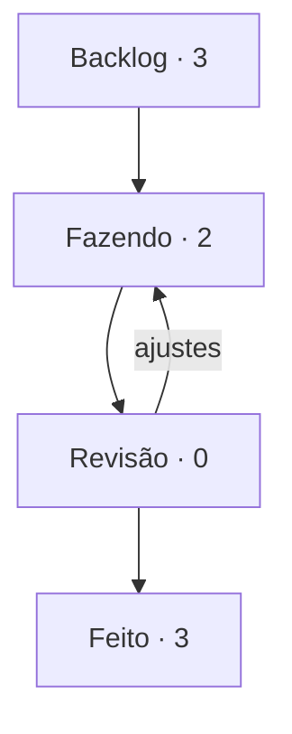

# Board · VibiKanban

> Gerado pelo `vk` a cada mudança. Não edite à mão: cada cartão é um arquivo em `board/cards/`.

## Backlog · 3

- **VK-4** CLI `vk status` no terminal — @leo `infra`
- **VK-5** Diagrama do fluxo em Mermaid — @isa `bend`
- **VK-6** Cartão some ao soltar fora da coluna — @bia `bug`

## Fazendo · 2

- **VK-2** Arrastar cartões entre colunas — @bia `ui`
- **VK-1** Componente .card na Bend-UI — @isa `ui`

## Revisão · 0

_vazio_

## Feito · 3

- **VK-7** Estrutura board/cards/*.md — @isa `ui`
- **VK-3** Gerar BOARD.md a cada mudança — @leo `bend`
- **VK-8** Leis do board em BOARD_LAWS.bend — @leo `bend`
