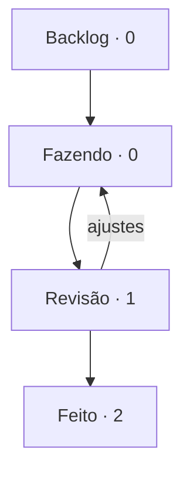

# Board · Dungeon Bend

> Gerado pelo `vk` a cada mudança. Não edite à mão: cada cartão é um arquivo em `boards/dungeon-bend/cards/`.

## Backlog · 0

_vazio_

## Fazendo · 0

_vazio_

## Revisão · 1

- **DB-1** ddsd — @isabellaherman `ui`

## Feito · 2

- **DB-2** dfdfd — @isabellaherman `ui`
- **DB-4** dddd — @isabellaherman `ui`
