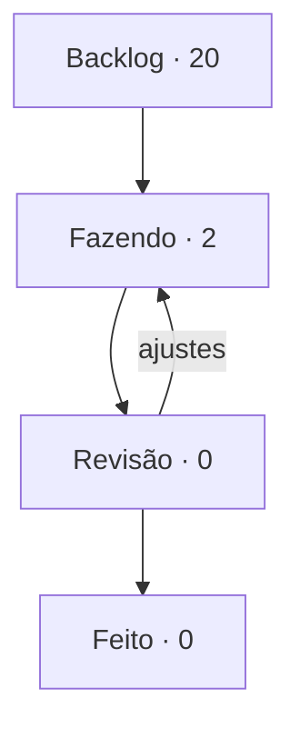

# Board · Dungeon Bend

> Gerado pelo `vk` a cada mudança. Não edite à mão: cada cartão é um arquivo em `boards/dungeon-bend/cards/`.

## Backlog · 20

- **DB-5** Implementar sistema de logue e ganhe — @Ostrowskii @isabellaherman `ui` · 0/7 · espera DB-22
- **DB-24** DB lista de amigos — @Ostrowskii @isabellaherman
- **DB-28** Arte para o evento de fim de semana
- **DB-22** art do log e ganhe
- **DB-3** Sistema de composição de deck — @isabellaherman `Game design`
- **DB-2** Dar continuidade no sistema de embaralhamento — @isabellaherman `Game design` `ui`
- **DB-7** 11 Arte dos items em composicao, cada item precisa de um asset especial. — @ilymeiib `Art`
- **DB-4** Modo de jogo: evento — @isabellaherman
- **DB-6** Definir tasks pro time de arte — @isabellaherman
- **DB-8** Quests — @Leon-nis `Game design` `ui`
- **DB-9** Publisher — @isabellaherman
- **DB-10** Endless Balance, pra jogadores que gostam de jogar o late game (nivel 15+) — @Leon-nis `Game design`
- **DB-11** Game Mode: Challenge. Modo de Jogo com Timer — @Leon-nis `Game design` `ui`
- **DB-16** Padronizar o patch note público — @isabellaherman
- **DB-17** Icone para o novo sistema de composição — @isabellaherman
- **DB-18** UX: Classes do sistema de combo — @isabellaherman `ui`
- **DB-19** Feedbacks: Sistema de combo e ativação do deck — @isabellaherman `ui`
- **DB-20** WARD WEAVER — @isabellaherman
- **DB-25** refinamento bend — @Ostrowskii
- **DB-29** Dungeon Pocket — objetivos macro do port — @mete-marcha `Production` · 0/11 · IA
  - **DB-30** Mapeamento do DungeonBend para port 1:1 — @mete-marcha `Production` · 0/3 · Fazendo · IA

## Fazendo · 2

- **DB-12** Ajustes, Otimizacoes e Bugs — @Leon-nis `bug`
- **DB-23** Multiplayer mode: weekend duels — @isabellaherman @Ostrowskii `development` `ui` · 4/10 · espera DB-28

## Revisão · 0

_vazio_

## Feito · 0

_vazio_
