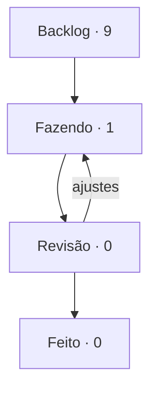

# Board · Dungeon Bend

> Gerado pelo `vk` a cada mudança. Não edite à mão: cada cartão é um arquivo em `boards/dungeon-bend/cards/`.

## Backlog · 9

- **DB-2** Dar continuidade no sistema de embaralhamento — @isabellaherman `Game design` `ui`
- **DB-7** 11 Arte dos items em composicao, cada item precisa de um asset especial. (Art) — @Leon-nis
- **DB-4** Modo de jogo: evento — @isabellaherman
- **DB-5** Implementar sistema de logue e ganhe — @Ostrowskii
- **DB-6** Definir tasks pro time de arte — @isabellaherman
- **DB-8** Quests — @Leon-nis
- **DB-9** Publisher — @isabellaherman
- **DB-10** Endless Balance, pra jogadores que gostam de jogar o late game (nivel 15+) — @Leon-nis
- **DB-11** Game Mode: Challenge. Modo de Jogo — @Leon-nis

## Fazendo · 1

- **DB-3** Sistema de composição de deck — @isabellaherman

## Revisão · 0

_vazio_

## Feito · 0

_vazio_
