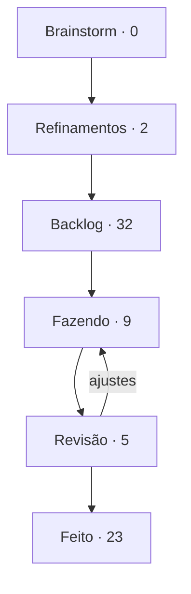

# Board · Dungeon Bend

> Gerado pelo `vk` a cada mudança. Não edite à mão: cada cartão é um arquivo em `boards/dungeon-bend/cards/`.

## Brainstorm · 0

_vazio_

## Refinamentos · 2

- **DB-46** bug visual: aviso de att pisca — @Ostrowskii
- **DB-47** qual booster estamos? — @Ostrowskii

## Backlog · 32

- **DB-5** Implementar sistema de logue e ganhe — @Ostrowskii @isabellaherman `ui` · 0/7 · espera DB-22
- **DB-24** DB lista de amigos — @Ostrowskii @isabellaherman
- **DB-28** Arte para o evento de fim de semana
- **DB-22** art do log e ganhe `Art`
- **DB-3** Sistema de composição de deck — @isabellaherman `Game design`
- **DB-4** Modo de jogo: evento — @isabellaherman @Leon-nis
- **DB-6** Definir tasks pro time de arte — @isabellaherman
- **DB-9** Publisher — @isabellaherman
- **DB-10** Endless Balance, pra jogadores que gostam de jogar o late game (nivel 15+) — @Leon-nis `Game design`
- **DB-11** Game Mode: Challenge. Modo de Jogo com Timer — @Leon-nis `Game design` `ui`
- **DB-16** Padronizar o patch note público — @isabellaherman
- **DB-17** Icone para o novo sistema de composição — @isabellaherman
- **DB-18** UX: Classes do sistema de combo — @isabellaherman `ui`
- **DB-19** Feedbacks: Sistema de combo e ativação do deck — @isabellaherman `ui`
- **DB-20** WARD WEAVER — @isabellaherman
- **DB-25** refinamento bend — @Ostrowskii
- **DB-38** Atualizacao do Ranking, 2 categorias com 3 topicos cada. Incluir arquivamento de ranking por temporada — @Leon-nis `Game design` `ui` · 1/2
  - ✓ **DB-54** Criar o criterio de fama — @Leon-nis `development` · 1/1 · Feito
    - ✓ **DB-55** testar a branch de fame-ranking — @Leon-nis `Testing` · Feito
  - **DB-56** Design da scene de ranking com novos topicos — @isabellaherman @Leon-nis `development` · Backlog
- **DB-40** Meeting, progressao interna da run. Experiencia, Combos e Acumulos — @Leon-nis `Game design`
- **DB-41** Construcao do Patch notes geral, pra comunidade — @Leon-nis `Discord` · espera DB-16
- **DB-58** Interface descritiva da scene de stats/substats — @Leon-nis @isabellaherman `ui`
- **DB-74** Art tasks/dez — @Leon-nis · 0/2 · espera DB-77
  - **DB-78** Item Composition: Potions extra (5 assets) · Backlog
  - **DB-79** Item Composition: Giant Potions (2 assets) · Backlog
- **DB-77** Meeting, Rewards Art feat/quests — @Leon-nis @isabellaherman `Game design`
_aninhadas no pai: **DB-67** (em DB-62), **DB-69** (em DB-8), **DB-70** (em DB-8), **DB-71** (em DB-62), **DB-72** (em DB-8), **DB-73** (em DB-8), **DB-76** (em DB-8)_

## Fazendo · 9

- **DB-2** Dar continuidade no sistema de embaralhamento — @isabellaherman `Game design` `ui` · 0/2
- **DB-23** Multiplayer mode: weekend duels — @isabellaherman @Ostrowskii `development` `ui` · 4/10 · espera DB-28
- **DB-29** Dungeon Pocket — objetivos macro do port — @mete-marcha `Production` · 4/16 · IA
  - ✓ **DB-30** Mapeamento do DungeonBend para port 1:1 — @mete-marcha `Production` · 3/3 · Feito · IA
  - **DB-31** Decisões de base do port (viewports, referência, fontes, ouro, revisão) — @mete-marcha `Production` `Game design` · 7/10 · Fazendo · IA
  - **DB-32** Harness de referência web (Playwright) para o 1:1 — @mete-marcha `Testing` `development` · 4/5 · Revisão · IA
  - **DB-37** Criar projeto Unity 6000.4.5f1 mobile — @mete-marcha `development` · Revisão · IA
  - ✓ **DB-59** Passo 3/4: import settings, espelho de assets e importador de data — @mete-marcha `development` · 8/8 · Feito · IA
  - **DB-60** Passos 5–11: motor C#, save, base visual e primeiras telas — @mete-marcha `development` · 0/7 · Fazendo · IA
- **DB-48** Arte para os ícones de classes — @oootavio `Art`
- **DB-8** feat/quests — @Leon-nis · 1/6
  - ✓ **DB-68** New Quests(Starting, Unique, Daily) — @Leon-nis `Game design` · Feito
  - **DB-69** UI placeholder Quests — @Leon-nis `Testing` · Backlog
  - **DB-70** Editor rewards: Quests — @Leon-nis `development` · Backlog
  - **DB-72** Artifact: feat/quests `Production` · Backlog
  - **DB-73** Testing: feat/quests `Testing` · Backlog
  - **DB-76** Infra: feat/quests — @Leon-nis @Ostrowskii `infra` · Backlog
- **DB-62** fix/rework-gold — @Leon-nis · 4/6
  - ✓ **DB-63** Boosters limit content — @Leon-nis `development` · Feito
  - ✓ **DB-64** Deckbox shop — @Leon-nis `ui` · Feito
  - ✓ **DB-65** Deckbuilder gold exhibition — @Leon-nis `ui` · Feito
  - ✓ **DB-66** Deckbuilder gold and hp scales — @Leon-nis `development` · Feito
  - **DB-67** Artifact: Patch notes & PR #138 rework-gold — @Leon-nis `Production` · Backlog
  - **DB-71** Testing: rework-gold — @Leon-nis `Testing` · Backlog
- **DB-75** GDD: Progressao & Balanceamento — @Leon-nis `Pitch` `Production`

## Revisão · 5

- **DB-12** Ajustes, Otimizacoes e Bugs — @Leon-nis `bug` · 1/1
  - ✓ **DB-33** PR feito · Feito
- **DB-39** Campo implicito: Fame, para monstros — @Leon-nis `development` · 1/1
  - ✓ **DB-45** Reuniao de apresentacao — @isabellaherman @Leon-nis `Game design` · Feito
- **DB-42** Revisar branchs do leon — @isabellaherman `Game design` · 2/2
  - ✓ **DB-43** mobs-v2 https://discord.com/channels/1466162797380505703/1468268698463768762/1573198989065461851 `Game design` · Feito
  - ✓ **DB-44** graveyard-piles https://discord.com/channels/1466162797380505703/1468268698463768762/1573126130947592212 — @isabellaherman `Game design` · Feito
_aninhadas no pai: **DB-32** (em DB-29), **DB-37** (em DB-29)_

## Feito · 23

- ✓ **DB-35** Meeting sobre gold e gold drop e seus incentivos. — @Leon-nis `Game design` · 1/1
  - ✓ **DB-53** remover "bad luck" do loot drop · Feito
- ✓ **DB-61** Define dungeon bend scope — @isabellaherman
- ✓ **DB-52** fix/intro-esc-deckbuilder-qol — @Leon-nis `bug` `ui` · 1/1
  - ✓ **DB-57** testing: intro-esc-deckbuilder — @Leon-nis `Testing` · Feito
- ✓ **DB-50** Testing: feat/mimic-loot-skip — @Leon-nis `Testing` `bug`
- ✓ **DB-51** Testing: Event mode na develop 2fafd909 (PR #127 + #128) — @Leon-nis @Ostrowskii `Testing`
- ✓ **DB-49** Correcao da Scene do drop loot para ficar de acordo com o mimic eliminado — @Leon-nis `bug`
- ✓ **DB-34** Meeting de Briefing dos 11 items — @Leon-nis @ilymeiib `Game design`
- ✓ **DB-36** Meeting sobre ultimate e pontos por movimento. — @Leon-nis `Game design`
_aninhadas no pai: **DB-68** (em DB-8), **DB-66** (em DB-62), **DB-65** (em DB-62), **DB-64** (em DB-62), **DB-63** (em DB-62), **DB-59** (em DB-29), **DB-55** (em DB-54), **DB-54** (em DB-38), **DB-43** (em DB-42), **DB-44** (em DB-42), **DB-45** (em DB-39), **DB-33** (em DB-12), **DB-30** (em DB-29)_
