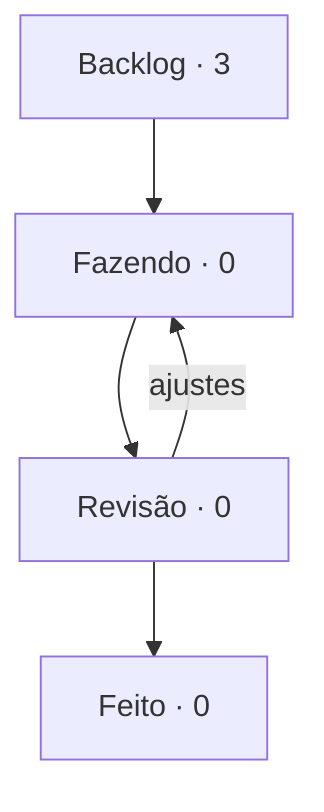

# Board · Dungeon Bend

> Gerado pelo `vk` a cada mudança. Não edite à mão: cada cartão é um arquivo em `boards/dungeon-bend/cards/`.

## Backlog · 3

- **DB-1** Feedback Leon — @isabellaherman
- **DB-2** Sistema de embaralhamento — @isabellaherman
- **DB-3** Sistema de composição de deck — @isabellaherman

## Fazendo · 0

_vazio_

## Revisão · 0

_vazio_

## Feito · 0

_vazio_
