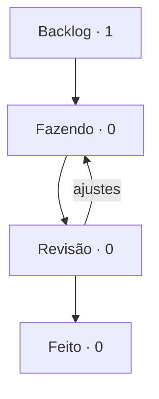

# Board · Dungeon Pocket

> Gerado pelo `vk` a cada mudança. Não edite à mão: cada cartão é um arquivo em `boards/dungeon-pocket/cards/`.

## Backlog · 1

- **DP-1** Dungeon Pocket — objetivos macro do port — @mete-marcha `Production` · 0/10

## Fazendo · 0

_vazio_

## Revisão · 0

_vazio_

## Feito · 0

_vazio_
