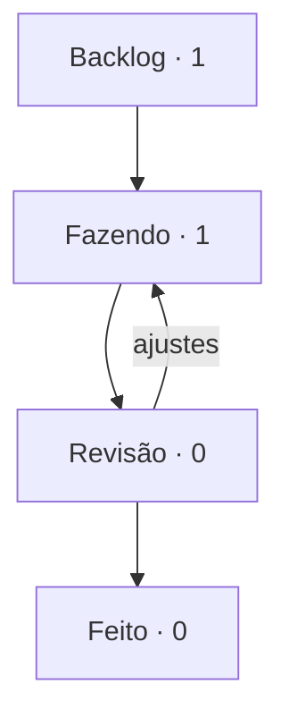

# Board · Geral

> Gerado pelo `vk` a cada mudança. Não edite à mão: cada cartão é um arquivo em `boards/geral/cards/`.

## Backlog · 1

- **GE-1** simulando art 3d com gaussian splats — @Ostrowskii

## Fazendo · 1

- **GE-2** Unblock Vibi Mercury account — @isabellaherman

## Revisão · 0

_vazio_

## Feito · 0

_vazio_
