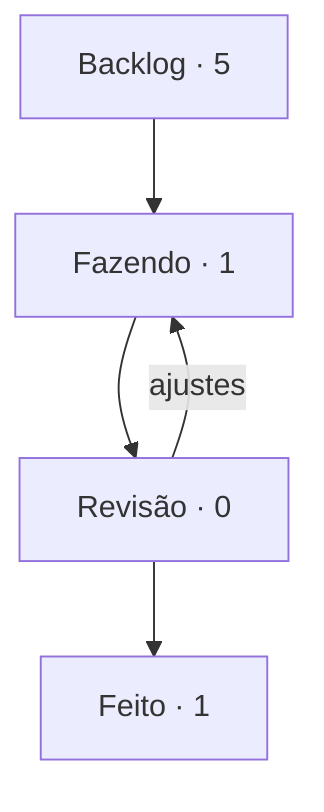

# Board · Geral

> Gerado pelo `vk` a cada mudança. Não edite à mão: cada cartão é um arquivo em `boards/geral/cards/`.

## Backlog · 5

- **GE-3** Barra de pesquisa personalizada no Kanban, pra evitar tasks duplicadas — @isabellaherman
- **GE-4** Subtask: Formato de Link ou Lista — @isabellaherman
- **GE-5** Filtro de Task — @isabellaherman
- **GE-6** Criar Kanban e organizar estrutura — @isabellaherman
- **GE-7** kanban: criar mais um espaço para tarefas — @Ostrowskii

## Fazendo · 1

- **GE-2** Unblock Vibi Mercury account — @isabellaherman

## Revisão · 0

_vazio_

## Feito · 1

- ✓ **GE-1** simulando art 3d com gaussian splats — @Ostrowskii
