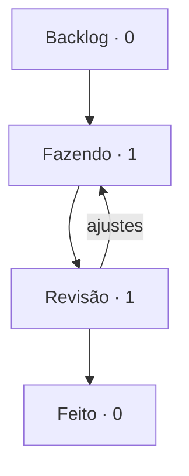

# Board · Harness

> Gerado pelo `vk` a cada mudança. Não edite à mão: cada cartão é um arquivo em `boards/harness/cards/`.

## Backlog · 0

_vazio_

## Fazendo · 1

- **HN-1** preciso encontrar pontos de melhoria — @Ostrowskii `ui`

## Revisão · 1

- **HN-2** Ongoing iteration: estabilizando a v1 do harness — @isabellaherman `bend`

## Feito · 0

_vazio_
