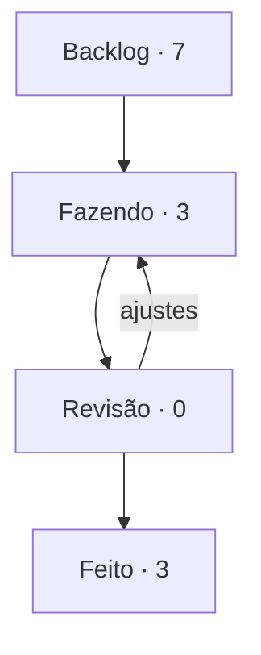

# Board · Harness

> Gerado pelo `vk` a cada mudança. Não edite à mão: cada cartão é um arquivo em `boards/harness/cards/`.

## Backlog · 7

- **HN-4** Corrigir o problema de multiplos chats — @isabellaherman
- **HN-5** botão open project in a new tab — @isabellaherman `ui` `bend`
- **HN-6** aumentar contraste de cor ou sensação de divisória da lib bend-ui — @isabellaherman `ui`
- **HN-7** laws: melhorar fluxo de visualizar e manejar laws — @Ostrowskii
- **HN-10** Showcase do harness — @Ostrowskii
- **HN-11** we can use Steam visual pattern for our "vibigames" page — @Ostrowskii
- **HN-13** Idealizar game jam na plataforma Vibi Click — @isabellaherman

## Fazendo · 3

- **HN-9** Objetivo da semana — @isabellaherman
- **HN-12** Concept para personagem HOC — @ilymeiib `art`
- **HN-14** Idealizar o sistema de artefato — @isabellaherman

## Revisão · 0

_vazio_

## Feito · 3

- ✓ **HN-3** Terminal: como implementar um terminal dentro do harness — @isabellaherman `infra`
- ✓ **HN-2** Ongoing iteration: estabilizando a v1 do harness — @isabellaherman `bend`
- ✓ **HN-8** bugfix: a v1 do harness e mandar pra nico — @isabellaherman `bend` `bug`
