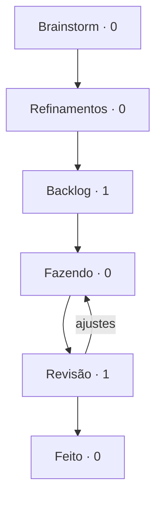

# Board · Morrow Days

> Gerado pelo `vk` a cada mudança. Não edite à mão: cada cartão é um arquivo em `boards/morrow-days/cards/`.

## Brainstorm · 0

_vazio_

## Refinamentos · 0

_vazio_

## Backlog · 1

- **MD-2** Itens e móveis — @ilymeiib

## Fazendo · 0

_vazio_

## Revisão · 1

- **MD-1** teste — @isabellaherman `bug`

## Feito · 0

_vazio_
